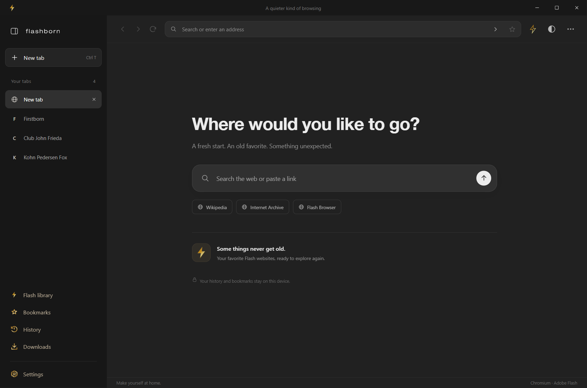
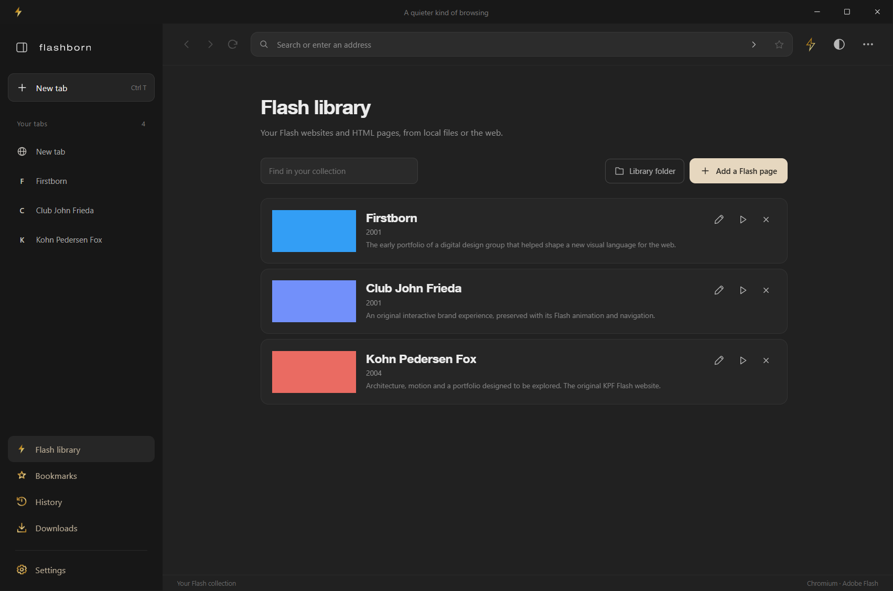
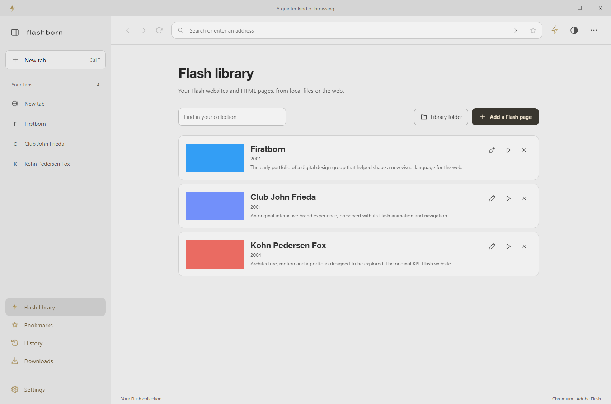
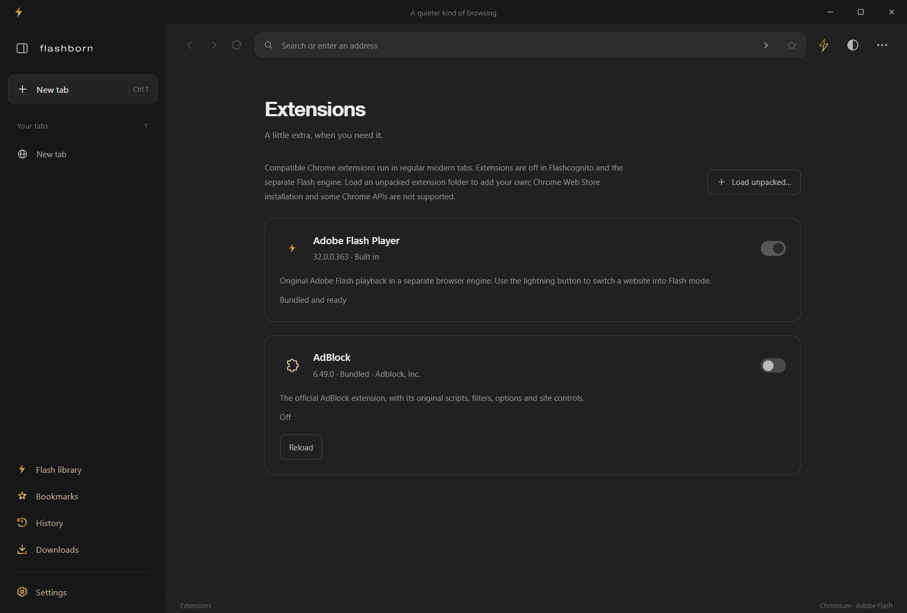
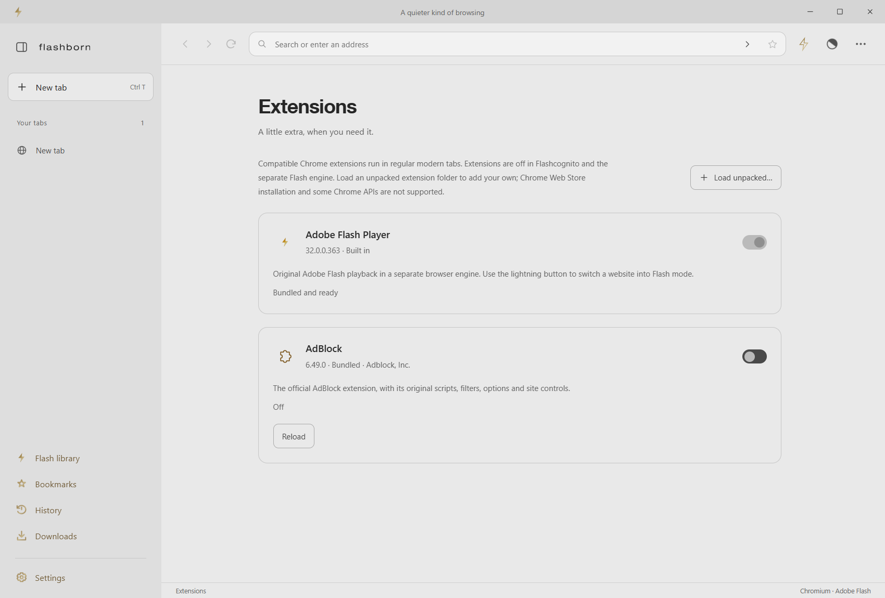
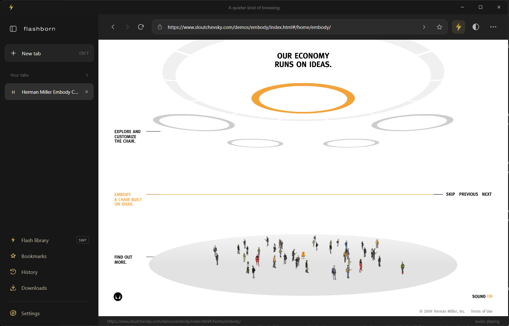
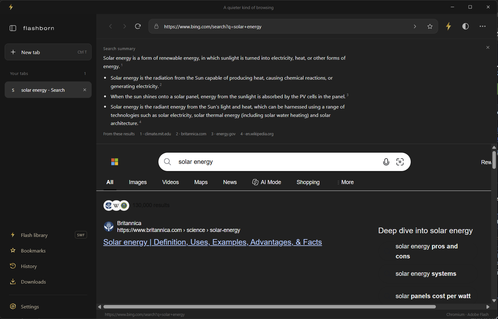
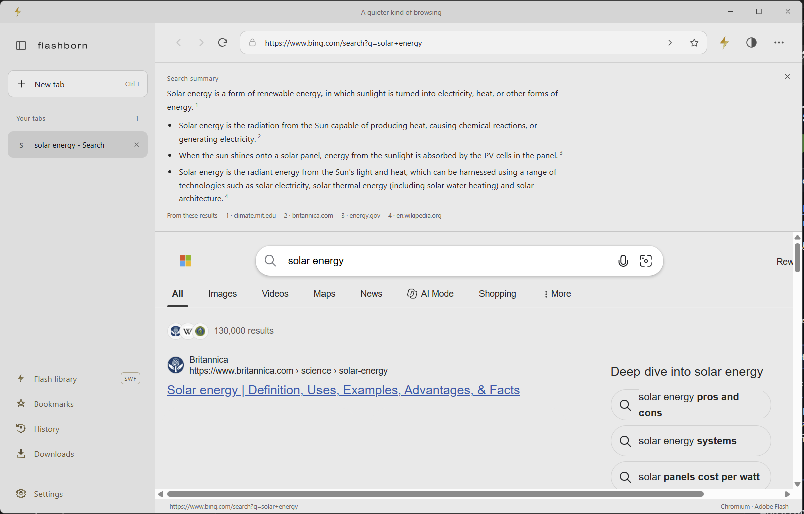
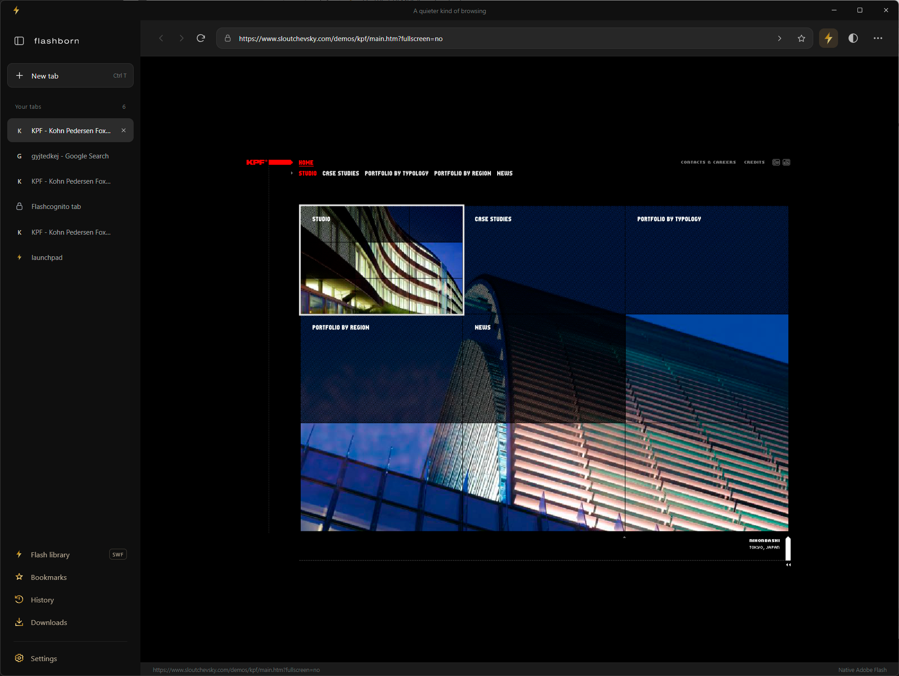
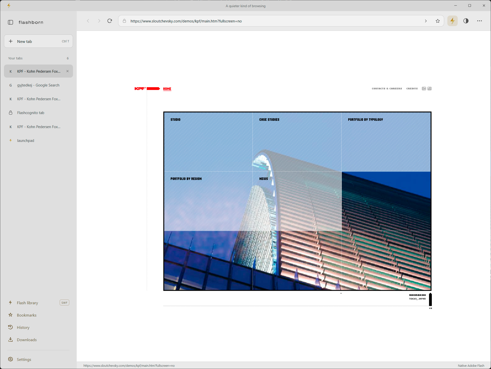

# Flashborn Browser

A minimal dark Windows browser with current Chromium for ordinary pages and
the original, Adobe-signed Flash Player 32.0.0.363 for Flash content.

**Current version: 1.11.0 · Windows 10/11 · x64 · MIT application source**

[Download the Windows installer](https://github.com/sloutchevsky/Flashborn-Browser/releases/download/v1.11.0/Flashborn-Setup-1.11.0-x64.exe)
· [Releases and update notes](https://github.com/sloutchevsky/Flashborn-Browser/releases)
· [Current source](https://github.com/sloutchevsky/Flashborn-Browser/releases/download/v1.11.0/Flashborn-Source-1.11.0-GitHub.zip)

See [the complete version history](CHANGELOG.md) for all releases, from the
initial Ruffle build to native Adobe playback and the current browser.

## A quieter way to browse

Tabs belong on the left, where you can read their titles. New tabs appear at the
top and drag into the order you want. The clear title bar has room to grab and
move the browser, without a row of tabs or other distractions.

Keep pages, documents and Flash movies in one browser window, instead of
scattering windows across your desktop. A compact interface, a flat three-dot
menu with inline controls, and just the essential settings keep navigation
simple. Official AdBlock is ready in regular modern tabs. Address completion
shows familiar pages and search predictions, with no AI mode. Search summaries
start off; turn them on if you want them.

See [what changed in 1.11.0](docs/release-notes-1.11.0.md).

## Extensions, Flash and sRGB out of the box

- **Extensions:** manage compatible unpacked Chrome extensions, their options
  and popups. Electron supports a subset of Chrome's extension APIs.
- **Official AdBlock:** bundled and enabled by default in ordinary modern tabs,
  with its original filters and site controls. Private tabs and Flash use
  separate engines/sessions.
- **Original Adobe Flash:** bundled playback for trusted legacy websites,
  for embedded Flash and standalone SWFs, with a detection/recovery bolt,
  remembered per-page quality and a built-in runtime card in Extensions.
- **sRGB:** both browsing engines explicitly start in sRGB, with no user flag
  changes needed in Flashborn. Browser theme changes leave website colors alone.
- **Privacy:** choose history, cookies/site data and cached images/files under
  Settings, then use one Delete data button. Ordinary clipboard copying no longer
  opens Gmail's repeated write-permission dialog.

## Preview



| Flash library · dark theme | Flash library · light theme |
| --- | --- |
|  |  |

| Extensions · dark theme | Extensions · light theme |
| --- | --- |
|  |  |

[Preview the combined Privacy controls](previews/screenshots/v1.9.0/privacy-light.png).

Version 1.8.0 restores automatic playback of the Embody website:



| Search summary · dark theme | Search summary · light theme |
| --- | --- |
|  |  |

| Dark theme · native Flash | Light theme · native Flash |
| --- | --- |
|  |  |

[View all 10 screenshots](previews/screenshots/README.md), including New Tab,
Flashcognito, search summaries, bookmarks, settings, the Flash Library and About.
These earlier screenshots include standalone SWF controls removed in 1.8.3;
version 1.11.0 restores playback with a simpler inline player.

## Install

Download and run `Flashborn-Setup-1.11.0-x64.exe` on Windows 10 or 11 x64. When
building locally, the same file is produced in `release/`. The installer
contains both browser engines and the Adobe player. No separate Flash install
is needed. Close the previous Flashborn version before updating. Settings,
bookmarks, history and the Flash library are retained.

Version 1.11.0 restores standalone SWFs inside browser tabs. Drop a SWF or HTML
file into the window, use Open File, or open a SWF with Flashborn from Windows.
On its first installed launch, Flashborn registers in Windows' SWF Open With
choices. If another app is already the default, choose Open with → Flashborn →
Always once to use double-click playback. The installer is unchanged.
Background metadata is read from the SWF, with light grey as the fallback.
Website/HTML library entries, PDFs, images and video remain supported.

The default Flash path no longer polls loading or calls movie APIs automatically.
Quality overrides use one call per instance without rewriting embed attributes.
Both browser engines start in sRGB mode, matching Chrome’s Force color profile setting.
Theme changes do not touch the Flash page or restart its movie. Flash runs in an unowned window with
its own Windows input queue, so a stalled legacy host cannot lock the modern
address bar, tab controls or context menus. Reload replaces the entire Flash tab
runtime, preserving its source, zoom and mute settings. The legacy renderer uses
normal process priority, matching Flash Browser; hidden tabs still throttle timers.
The active Flash viewport stays directly above its own shell in the normal
window stack, below browser popups and any other application covering the
browser. Losing focus keeps the same movie alive; minimizing hides it. A
hung hidden host is terminated to prevent it floating above other applications.
A deliberate 30-second host hang is covered by the isolation regression check.
This does not establish that every legacy movie or site is free of internal stalls.

This build is unsigned; Windows can show an unknown publisher
or SmartScreen prompt. Uninstall through Windows Settings → Apps.

The Windows install/uninstall consent prompt takes its verified publisher from
an Authenticode signature, not the installer’s publisher text or EXE company
metadata. A trusted code-signing certificate issued for the publisher is required.
This build does not have one. When a certificate or signing service is available,
configure electron-builder signing and use `npm run dist:signed`; that target
fails if signing is unavailable instead of silently producing an unsigned build.
For a PFX certificate, provide its path with `WIN_CSC_LINK` and its password via
`WIN_CSC_KEY_PASSWORD` in the build environment, outside source control.
The unused updater elevation helper is excluded. This does not remove SmartScreen
reputation checks. Signing identifies the publisher; a newly signed release can
still warn until reputation builds. See [Windows distribution notes](docs/windows-distribution.md).
See [Microsoft’s code-signing options](https://learn.microsoft.com/en-us/windows/apps/package-and-deploy/code-signing-options).

## Use

- Enter an address or search in the top bar. Press **Enter** or click **Go**.
- Right-click any tab for **Duplicate Tab** and **Close Tab**. New tabs,
  duplicates and linked pages open at the top, retaining the source's private mode.
- Choose **Flashcognito tab** from the three-dot menu, or press **Ctrl+Shift+N**.
  Silver bolts and a quiet new-tab page identify private tabs. Browsing history,
  restored tabs, automatic library additions and download records are not saved.
  Modern sites use a separate in-memory session; the native Flash engine also
  uses an in-memory session and removes its temporary profile when it exits.
  Closing the last private tab clears its temporary site data and download list.
  Bookmarks and downloaded files you explicitly keep remain on disk. Websites
  and your network can still see your activity.
- Open local HTML, SWF, PDF, image and video files with **Ctrl+O** or the three-dot menu.
- Drop HTML, SWF, PDF, image or video files onto the browser to open them in new tabs.
  Local HTML can load companion files within its folder.
- PDF links, PDF MIME responses and local PDF files display in Chromium’s PDF viewer.
- Image formats include PNG, JPEG, GIF, WebP, SVG, AVIF, BMP and ICO. Video formats
  include MP4/M4V, WebM, OGV and MOV; playback depends on Chromium codec support.
- The address bar and new-tab search complete known URLs from bookmarks, history
  and open tabs, and suggest previous search phrases. The Flash library address
  field also suggests saved local sources. Use Up/Down and Enter, click a
  suggestion, or press Escape to dismiss. URL completions retain the site's
  original HTTP/HTTPS scheme. Live text predictions come from your selected
  DuckDuckGo, Google or Bing search engine, with no AI mode. Only search phrases
  are sent; full URLs and local paths are excluded. Private predictions use no
  cookies or persistent prediction cache. Local results remain usable offline.
- Google, DuckDuckGo and Bing result pages receive a **Search summary** above the
  original page. It ranks useful passages from several loaded result snippets,
  removes repetition and promotional notices, and cites up to four distinct sources.
  It sends nothing to an external summary service. The panel animates down when
  ready, pushing the HTML viewport down, and aligns with the organic search results.
  Click × to dismiss it for that page visit; reloading makes it available again.
  The summary follows browser theme changes; search results retain their own colors.
  **Settings → Generate search summaries** is off by default; turn it on to add
  summaries to supported search pages. Summary text stays in memory, including
  in Flashcognito. Empty results, verification pages and unsupported page layouts
  show the original page without a summary.
- Drag tabs, bookmarks, downloads and Flash library entries to reorder them. With an item
  focused, Alt+Up/Down also moves it. Bookmark, download and library order is saved.
- When the sidebar collapses, its tabs heading shows only the number of open tabs.
- Hover an expanded tab to show its memory size immediately before Close. The
  title truncates as needed; memory disappears on rollout. Collapsed tabs show
  neither memory nor a popup. Normal pages report renderer private memory; Flash
  tabs include their dedicated runtime and player processes. Estimates stay local;
  measuring an inactive tab does not select it.
- A completed download shows **NEW** beside Downloads until that panel is opened.
  It remains visible when collapsed and across restart; private badges stay in
  their temporary session. Canceled downloads do not trigger it.
- Ctrl+mouse wheel and Ctrl+/− visibly zoom pages, with a Chrome-style percentage popup and Reset button.
- Right-click the address, home search or find field for Select all, Cut, Copy and Paste.
- Click the upper-left logo to open About. The copyright line opens sloutchevsky.com.
  The About email address copies on click and briefly shows a **Copied!** bubble.
- On New Tab, click the gold bolt tile or its caption to open the Flash library.
- App and installer icons use the first frame of the same darker gold animation.
  The Windows publisher/company metadata and installer welcome screen name Vas Sloutchevsky.
- Standalone SWFs play in their own tabs with their embedded background color,
  or light grey when none is available. Companion files resolve beside the movie.
- Pages with embedded Flash, including framesets, are detected and opened in native mode.
- Click the **lightning button** to check a page for Flash or restart its player.
  It works on every tab: hollow without detected Flash, filled when Flash is present.
- The title bar uses a static first frame of the same gold bolt, without the application name.
- The gold lightning button spins once every two seconds while loading, then
  finishes its current turn. The About screen uses a larger continuous animation.
- The half-filled circle switches between dark grey and light grey, rotating
  180 degrees each time. Theme choice is saved.
- The three-dot menu uses a separate popup window above Flash content, with
  inline Chrome-style zoom controls, fullscreen, and Adobe High/Medium/Low Flash quality.
  Its five groups contain new tabs/files; library, bookmarks, history and downloads;
  Print and Find; zoom/Flash controls; and Settings/About.
- High/Medium/Low quality applies to the current tab. Regular pages remember their
  choice after closing and reopening; private choices stay temporary.
- The sidebar provides tabs, bookmarks, history, downloads, settings and a Flash page library.
  The simple gold bolt is retained. The Flash library bolt and smaller bookmark
  star spin once on hover; the History arrow and hands complete a counterclockwise
  12-hour cycle; the Downloads arrow hits its tray and bounces back. The gear
  rotates around the same center as its hub and finishes its current turn when
  hover ends. The lights stay fixed, and reduced motion disables spins. Lower
  sidebar labels use a muted beige; light-mode icons are darker with less shine.
  Flashcognito uses the normal new-tab layout and fonts, cooler greys, a silver
  bolt, and 50% page opacity. The top-left wordmark and browser menu open About.
- Moving or resizing the browser aligns the independent Flash viewport using
  asynchronous Windows positioning, without joining its input queue to the UI.
- Flash library offers **Add a Flash page**. Enter a website URL or an absolute
  local HTML path, or choose **Browse**. Local HTML companion assets stay scoped
  to the selected folder. The main address bar also detects embedded Flash.
- Click a library thumbnail (a plus appears on hover), or drop an image onto it,
  to add a landscape **2:1** image. Click it to replace it; use its × to remove it.
  The original image stays untouched; the browser keeps a resized PNG copy in its profile.
- Edit a library card's title, year and longer description. The description wraps
  to two visible lines. The separate Flash Library manifest and images folder
  keeps the collection across upgrades and can be used to curate a portfolio.

The original demo `assets/Flashborn-Demo.swf` displays a moving cream square.
The library references your files; keep their companion assets in the same folder.
Missing game servers, external assets and site dependencies can still prevent playback.

## Compatibility and security

The bundled original Adobe Flash 32.0.0.363 DLL has SHA-256:

`4acafedca8bb62529527029aeb485318866e4fd71bf298e73f735bc75f6d720d`

Its original timestamped Adobe signature verifies as Valid. This replaces the
community-patched player introduced in 1.8.0, whose signature was invalidated.
The app, installer and legacy host remain unsigned. A valid player signature
cannot establish installer reputation or guarantee the absence of SmartScreen.
See [third-party notices](THIRD-PARTY-NOTICES.md).

Flashborn uses a separate Electron 9.4.4 / Chromium 83 process per native Flash
tab. Ordinary browsing and the application UI use Electron 44.7.0. The native
window has no cross-process parent or owner, keeping its input queue independent.
This is the real PPAPI player, not an emulator.

**The legacy Chromium engine used for Flash no longer receives security updates.**
Use native mode for trusted legacy content. Process separation is not a VM or a
guarantee against vulnerabilities in the old engine. Ordinary addresses entered
in the address bar return to modern Chromium; links within a native page remain
in native mode.

Both engines use isolated renderers without Node.js access. Certificate checks,
same-origin protections and website CSP stay enabled. Local HTML can serve
companion assets only inside its selected folder. Websites have no application
JavaScript bridge. Each native tab has separate cookies/storage; these are not
shared with modern pages or other native tabs, and are discarded when that native
tab closes. The modern engine prompts for
site permissions; native pages are allowed fullscreen only.

History, bookmarks, settings and library entries stay under
`%APPDATA%/flashborn-browser`. Uninstall keeps user data.
There is no analytics service or automatic updater. This custom browser does
not provide Chrome account sync, Chrome Web Store installation or DRM video.
Compatible unpacked Chrome extensions can be managed from the three-dot menu.

The application source is MIT licensed, copyright © 2026 Vas Sloutchevsky.
The spaced logo uses outlines from the user-installed
HelveticaNeueLT Com 53 Extended font, so the installer does not require or
redistribute that font. Regenerate those outlines with `scripts/create-brand.ps1`
when the original font is installed. Page headings use the bundled
Flashborn 75 Bold font, derived from Helvetica Neue LT Com 75 Bold, with
-20 tracking. Its outlines, hinting and kerning are retained. This third-party
font is excluded from the application MIT license; see THIRD-PARTY-NOTICES.md.

## Keyboard shortcuts

| Shortcut | Action |
| --- | --- |
| Ctrl+L | Address bar |
| Ctrl+T / Ctrl+W | New / close tab |
| Ctrl+Shift+N | New Flashcognito tab |
| Ctrl+Shift+T | Reopen closed website tab |
| Ctrl+Tab / Ctrl+Shift+Tab | Next / previous tab |
| Ctrl+1…9 | Select tab |
| Alt+Left / Alt+Right | Back / forward |
| Ctrl+R / F5 | Reload |
| Ctrl+O | Open HTML, PDF, image or video |
| Ctrl+D | Bookmark |
| Ctrl+F | Find in page |
| Ctrl+H / Ctrl+J | History / downloads |
| Ctrl+P | Print |
| Ctrl+Plus / Minus / 0 | Zoom |
| F11 / Esc | Fullscreen / leave fullscreen |
| F12 | Modern page developer tools |

## Build and validate

Requirements: Windows x64, Node.js 22.12+ (24 recommended), npm and the existing
Flash Browser installation at `C:\Program Files (x86)\FlashBrowser`. Override
its directory with `FLASHBORN_FLASH_BROWSER` if necessary. The preparation script
copies the original player, verifies its pinned checksum and valid Adobe
signature, copies the compatible runtime and replaces its application code with
Flashborn's helper. It leaves the installed browser
untouched. Native binaries are excluded from the source archive.

```powershell
npm ci
npm run prepare:icon
npm run prepare:assets
npm test
npm run test:smoke
npm run test:files
npm run test:refinements
npm run test:polish
npm run test:privacy
npm run test:ui-update
npm run test:predictions
npm run test:website
npm run test:sidebar
npm run test:window
npm run test:playback
npm run test:toolbar
npm run test:input-stability
npm run test:isolation
npm run test:theme-color
npm run test:summaries
npm run dist
npm run test:package
```

The build produces `release/Flashborn-Setup-1.9.0-x64.exe`. Run `npm start` for
development. `npm run dist:portable` produces a portable Windows executable.
Third-party binaries retain their respective licenses; the Adobe binary is not MIT.

## Languages and environment

| Component | Technology |
| --- | --- |
| Application, browser integration, tests and build scripts | JavaScript / Node.js |
| Browser interface | HTML and CSS |
| Gold and silver animations | JavaScript Canvas rendering, SVG assets |
| Logo outline generation | PowerShell and Windows font APIs |
| Windows installer customization | NSIS |
| Modern browser | Electron 44.7.0 / Chromium 152.0.7977.130 |
| Native Flash process | Electron 9.4.4 / Chromium 83 / Adobe Flash 32.0.0.363 PPAPI |
| Windows native integration | Koffi 3.3.2 / Win32 APIs |
| Packaging and browser checks | electron-builder 26.15.3 / Playwright 1.56.1 |

Experimental artwork in `previews/` is separate from the shipped UI. The
production app uses the simple lightning bolt, not the experimental serif shape.

## Release history and packaging

[CHANGELOG.md](CHANGELOG.md) lists the user-visible updates and relevant validation
for every archived release. [docs/version-manifest.json](docs/version-manifest.json)
records the historical source archive and installer sizes and SHA-256 checksums.
The imported historical Git commits and tags are reconstructed from those source
archives; their commit dates record the import, not the original development dates.

The installer belongs in a GitHub Release, rather than the Git source tree.
`node_modules/`, generated release output, native third-party binaries and test
profiles are excluded from version control. See [third-party notices](THIRD-PARTY-NOTICES.md)
for the licenses and provenance of bundled components.

Unit tests cover URL parsing, forbidden schemes, path containment, SWF headers
and profile persistence, reordering, supported file formats and autocomplete. Runtime tests launch the actual application with a
disposable profile and fixture server. They cover Enter/Go, navigation, tabs,
bookmarks, history, find, downloads, genuine Adobe version detection and frame
execution, rejection of direct/MIME SWFs, embedded objects, native mode,
menus and renderer isolation. It also verifies actual on-screen Flash pixels,
visibility after tab switching, framesets, and classic plugin detection scripts.
The file/UI checks cover real HTML, image, video and PDF drops, plus SWF drop rejection, relative assets,
URL suggestions, keyboard selection and the copyright link. Results and screenshots
are in `test-output`.

The prediction checks verify real DuckDuckGo, Google and Bing responses in both
search fields, selected-result navigation, offline fallback, cancellation of
outdated responses, exclusion of URLs and file paths, and private cache isolation.

The website-only checks verify migration from profiles containing standalone
SWF tabs and library records, selection preservation, removed routes/commands,
chooser filters, and absence of direct-open controls. They also check that theme,
visibility and repeated focus restoration do not make automatic Flash calls.

The playback checks use an original AVM1 movie with a frame clock and mouse/drag
callbacks. They cover settled playback without recurring settings calls, older
tab interaction, source/zoom/mute restoration, lazy startup and recovery from
terminated helpers or crashed renderers. The toolbar checks cover address and
Find focus while Flash reloads, keyboard shortcuts from the legacy renderer,
returning to the movie, inline memory dismissal and synchronized sidebar motion.

The sidebar checks measure gear centering across rotation angles, completion
after hover-out, collapsed counts, both themes, menu grouping, and real download
completion badges, including restart, acknowledgment, cancellation and privacy.

The isolation check deliberately blocks the legacy host for 30 seconds and waits
for Windows to report it as hung. It verifies that address editing, context menus
and tab switching remain responsive, then uses the real Reload button to replace
the runtime and restore the source, zoom and mute state.

The window checks count native frame/resize messages during physical moves,
verify real viewport resizing, and exercise hover memory for normal, inactive,
shared and Flash tabs. A touched 64 MB renderer allocation verifies the estimate
responds to actual usage. Set `FLASHBORN_KPF=1` to include the live KPF website.

The summary checks cover all three result layouts, animated viewport displacement,
result alignment, close/reload behavior, theme changes, source navigation, settings persistence, delayed DOM changes,
private-session isolation, and the absence of additional network requests.
Live Bing's updated summary and both themes were verified in 1.8.0. Live DuckDuckGo
was also verified in 1.7.3; Google presented a verification page during the live
check, so its results adapter is verified with fixtures.

The polish checks verify the exact first-frame title bolt, the smaller About branding, 40px text offset, theme-independent grey metadata,
real Adobe Low/Medium/High quality and quality persistence after restart.

The privacy checks exercise the tab context menu and duplication, private cookie
and local-storage isolation, download records, real Adobe execution in private
tabs, temporary-profile deletion, clean sessions after the last private tab closes,
and ordinary-only restoration after restart. They also verify the gold hover
icons, reduced motion, and private HTML Flash duplication.

Version 1.1.1 fixes native windows that were rendering while Electron considered
them hidden. Visibility is now synchronized with the legacy BrowserWindow itself.
Old Flash 2–9 detectors can misread a two-digit major version; their declared Flash
page is recovered only for the recognized detector shape and the same website.
Version-check update redirects are also recovered, including the Embody website.

To test an unpacked or extracted installer payload:

```powershell
$env:FLASHBORN_EXE = (Resolve-Path 'release/win-unpacked/Flashborn.exe').Path
npm run test:smoke
```

References: [Electron's Flash removal](https://www.electronjs.org/blog/electron-12-0)
and [Flash Browser](https://github.com/radubirsan/FlashBrowser).
