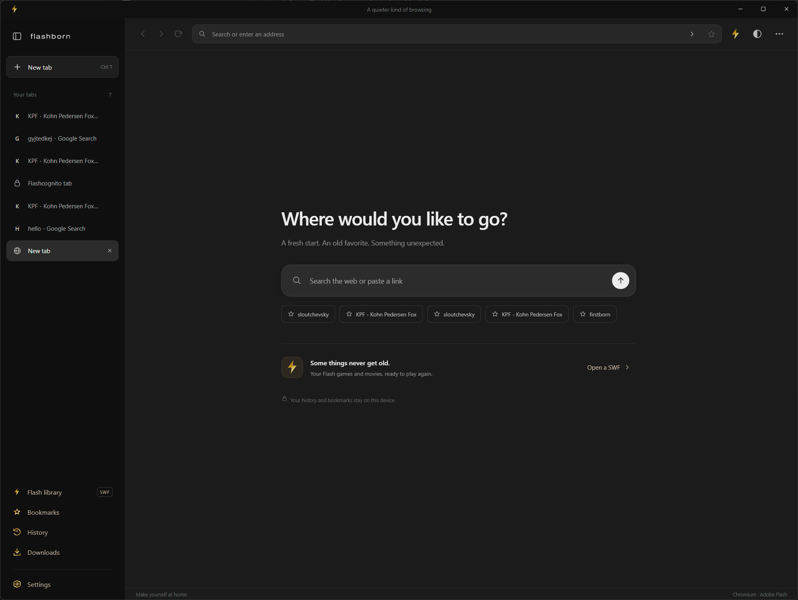
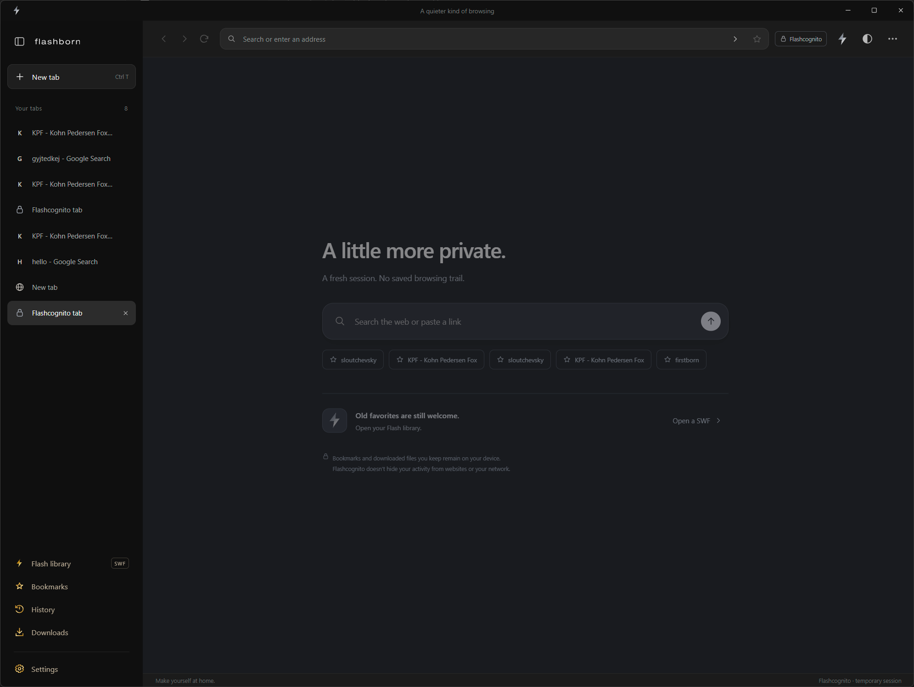
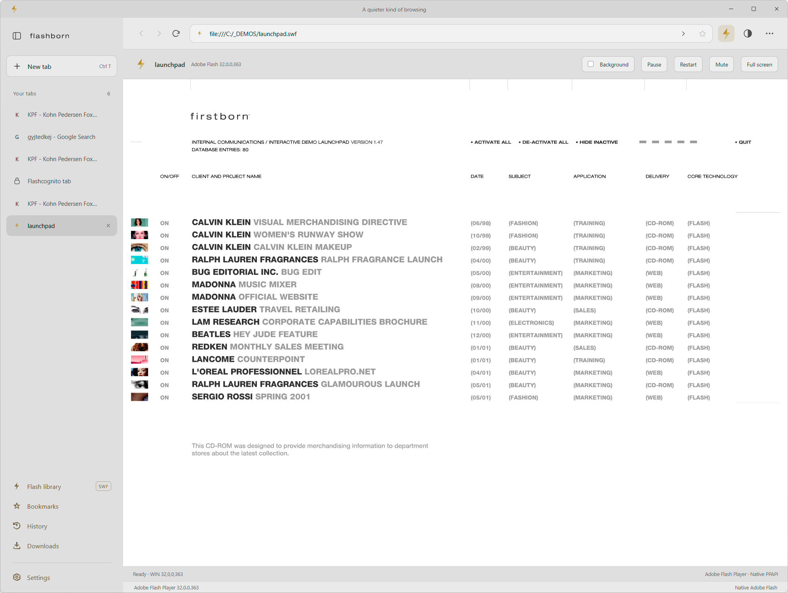
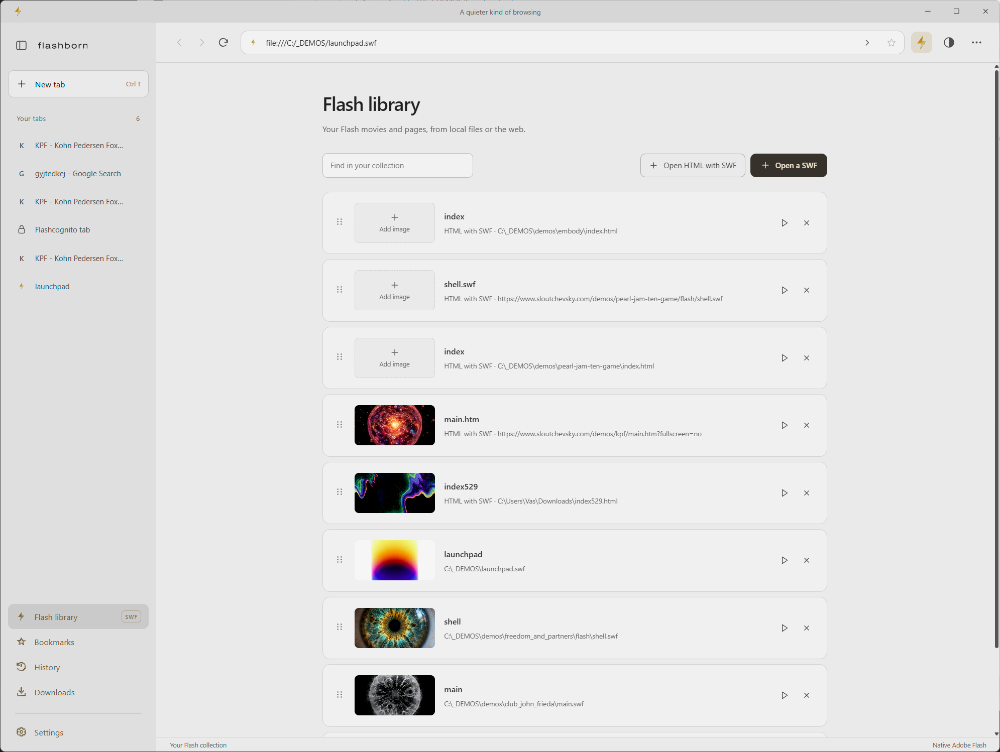
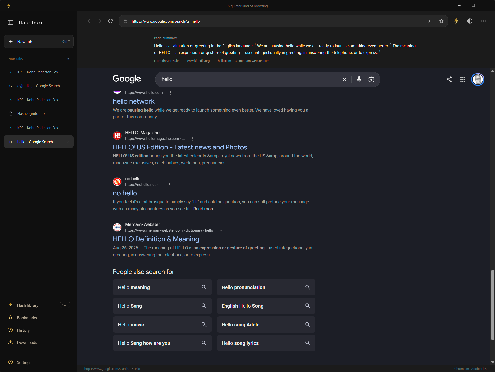
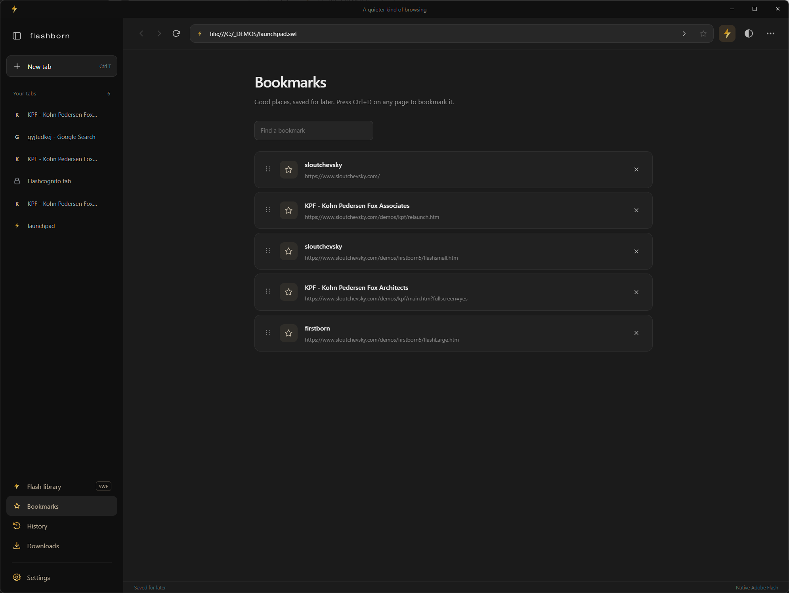
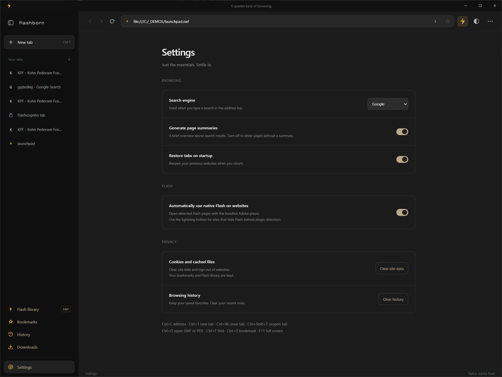
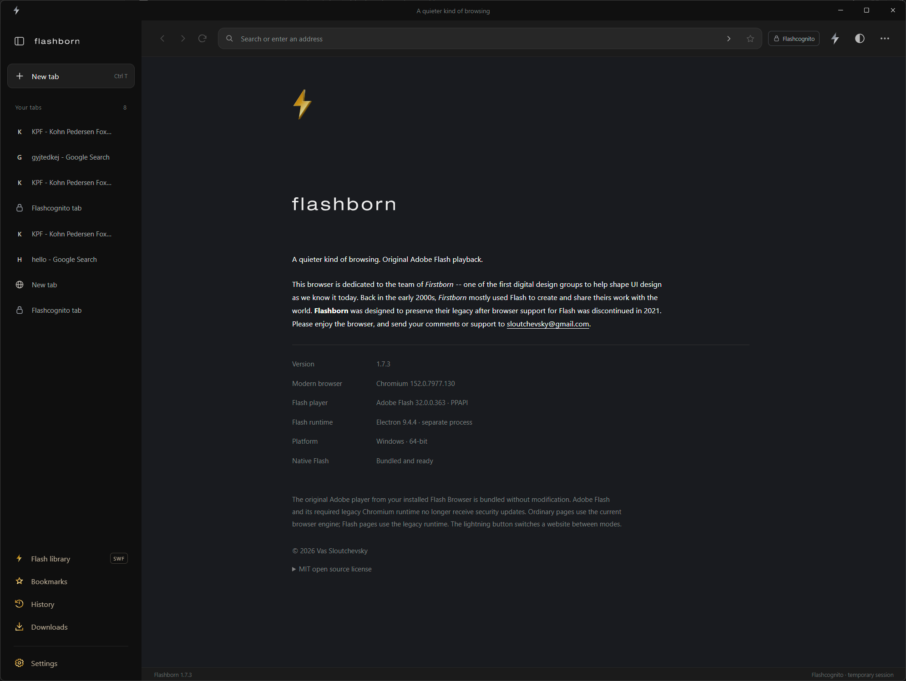

# Flashborn Browser screenshots

Screenshots of Flashborn 1.7.3, showing dark and light themes and original Adobe
Flash playback. The supplied PNGs are preserved at their original resolution.

## New Tab · dark theme

## Flashcognito · dark theme

## Native Flash · dark theme

## Native Flash · light theme

## Firstborn Flash launchpad · light theme

## Flash Library · light theme

## Search summaries · dark theme

## Bookmarks · dark theme

## Settings · dark theme

## About · dark theme

